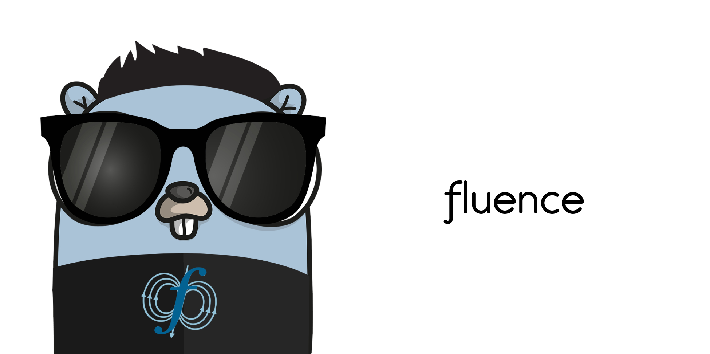

# fluence


[](https://badge.fury.io/py/fluence-hpc)

🚧 **UNDER DEVELOPMENT** 🚧 Thank you for your patience! -@vsoch

Fluence is a Kubernetes scheduler plugin. It builds a [Fluxion](https://github.com/flux-framework/flux-sched) resource graph from the live cluster and places pods, alone or in groups, by matching them against it. The graph does not have to stop at compute. Anything with a count and a few attributes can be a vertex in it, and then you can filter on it and the pod that gets it learns what it got through its environment. Quantum backends were the first thing I modeled this way, but there is nothing quantum specific in the design.

This replaces [flux-k8s](https://github.com/flux-framework/flux-k8s). Gangs go through the native Kubernetes PodGroup API now, and there is no dependency on kubernetes-sigs/scheduler-plugins. I worked out the quantum resource model first in [fluxion-quantum](https://github.com/converged-computing/fluxion-quantum).

## How it works

```console
 resources.yaml --+
   +--------------+-------------------------------+
   v              v                               v
scheduler     device plugin                    webhook
(pkg/fluence)  (advertises types)           (injects env)
   |
   |  build graph                (pkg/cluster -> pkg/jgf)
   |  generate jobspecs          (pkg/placement -> pkg/jobspec)
   |  match + cancel via Fluxion (pkg/graph, cgo)
   |  parse allocation           (pkg/graph, pkg/placement)
   v
 pod bound to a node + backend/attrs stamped as annotations
                          |
                          v
           webhook-injected env reads those annotations
```

There is one resources.yaml used by the scheduler, a device plugin, and webhook. The scheduler builds the graph from it and matches requests. The device plugin advertises the types in it as extended resources, which is only there so a pod asking for one gets past the NodeResourcesFit check. The webhook reads it to know which environment variables to inject. I could drop the device plugin, and I have kept it for the day we have resources that really are tied to a node. Until then the counts are quotas.

When a group comes in, the scheduler writes one or more jobspecs for it, matches each one against the graph, and if any of them fails it cancels the rest. Any nested topology for quantum devices would be represented in the graph structure. Then fluence binds the pods and adds annotation attributes. The webhook already gave the containers downward API variables that read those annotations, so by the time the container starts it knows its backend.

## The resource model

Everything in the graph that can be allocated is a node vertex. That includes the real nodes and every level of every virtual resource. I did this because Fluxion only applies property constraints, RFC 31, to node and storage_node vertices, so a virtual resource has to be a node if you want to filter on it.

Real nodes have the attribute virtual=false and virtual resources have virtual=true. A full set of attributes might include virtual=true, class=qpu, and region=us-east-1, because RFC 31 only checks whether a key is present. You select a resource by its class, which means any level of the tree can be asked for on its own. Classes are inherited so a nested type is not pruned at its parent on the way down.

A vertex is the unit Fluxion allocates. Anything under a slot is taken whole, so a node modeled as one core vertex of size 64 could hold a single slot of a gang, and two pods of one gang could only land on two nodes. Real nodes are built the way Flux builds them, one vertex per core and per GPU. Memory is chunked, which is how flux-sched's own test graphs and Slurm's memory per CPU work. Each node gets one memory chunk per core, sized as the node's memory split over its cores in MiB, and a pod's request in MiB takes however many whole chunks cover it. The vertex count stays at about twice the cores, and the kubelet's own fit check still admits the pod with the exact bytes. This needs flux-sched 0.53 or newer. Older versions only match a partial chunk in a single slot.

## Resources

Here is an example of resources for AWS Braket.

```yaml
resources:
  - type: qdevice            # the resource class
    name: rigetti_cepheus    # vertex name, the backend identity
    parent: cluster          # where it attaches, cluster by default
    attributes: aws-east     # an inline map or a name from the registry below
    with:                    # children, same schema
      - type: qpu
        count: 1
        with:
          - type: qubit
            count: 80

attributes:
  aws-east:
    region: us-east-1
    connectivity: all-to-all
```

A missing type, an attribute name that is not in the registry, or a config with content but no resources key are all errors. I would rather it fail loudly than build an empty graph. The placement package turns a group into jobspecs. There is always one compute jobspec, a slot per pod, constrained to virtual=false. There is one more jobspec for each virtual type (e.g., quantum) the pods ask for. Every pod gets at least one core, and every jobspec has a duration of zero to ensure it is held until someone (the scout or user) cancels it.  The graph package is what interfaces with the Fluxion matcher via cgo, meaning it needs flux-sched to build. We use jgf as the match format because rv1 will not pass through a virtual allocation without cores in it. The fluence package is the scheduler plugin, and PreFilter matches the whole group and cancels everything if any match fails. Filter only lets through the nodes Fluxion picked. Reserve and PreBind write the backend annotations and the Fluxion job ids onto the owning object, which is the PodGroup for a gang and the pod otherwise. When that object is deleted an informer cancels the allocations. The job id annotation will persist through a restart. The gang semantics come from the PodGroup API, and fluence only does placement. The deviceplugin advertises types as `fluxion.flux-framework.org/type`, and this is done as a courtesy to the user (to make it easy to use). For virtual resources these counts can be viewed as limits. In practical terms, the real limit is the number of hybrid pairs that can be supported (we cannot exceed the number of free and pre-emptible cores if we expect priority to work on a released reservation).  The webhook is a mutating webhook that allows for registration of handlers, and the handlers mutate pods per a specific role. For example, the default fluence handler is a gang. There is also a quantum handler. Finally, the python module implements the sidecar and interceptors. We have to have one per vendor, but we do not have too many vendors, so we build just one sidecar for now. The user does not need to think about it, as fluence will inject it into containers when appropriate to submit quantum work.

## Quantum gangs

The two-queue problem is about co-scheduling of different queues. We typically control one, and not the other. A hybrid job without coscheduling would submit from classical resources and (likely) do a lot of waiting.  Fluence holds them out of the cluster until the task is about to run and then lets them in with high priority. A shared quantum gang gets split into a scout and workers, and the scout monitors and ungates the workers when the quantum is ready.

The scout is one pod of the gang, the one with completion index 0 in an indexed Job. It runs the application, submits the one quantum task, and has a sidecar. It is never gated. The workers are everyone else. They start with a scheduling gate so they hold no node resources while the task is in the vendor queue. They know their role, and when they are ungated they get the scout's job id and its session, so they can fetch the result or submit into that same session. The sidecar is what finds the task, watches the vendor queue, ungates the workers when the task is next in line, and then waits for the workers to finish so the scout keeps its session until they are done.

The vendor specific part lives in the providers. Braket tags a task and searches for it later. QRMI has no tag search, so its interceptor writes the job id and session to a file that the sidecar reads. QRMI covers IBM, Pasqal, IQM, and others through one API, and the vendor is just an attribute in the config.

## Admission control

Admission control is a check that asks "Can we support a new hybrid queue?" where that question is based on our ability to release a reservation with priority and guarantee that it can run given free cores and pre-emptible work. It is always on, and you can turn it off at your own risk by setting FLUENCE_ADMISSION=off in the webhook deployment read at startup. When turned on, the webhook will refuse a new quantum group that will not fit. This design is analogous to what we do with the flux-quantum jobtap plugin. In simple terms, we add up the cores every pod in the group will need, plus the cores already promised to groups that were admitted but have not started. That has to fit in the set of free plus preemptible cores (lower priority). A group that does not fit is refused when its first pod is created, so you see it at kubectl apply or on the Job. Every quantum pod gets marked protected so it never counts as preemptible.

## Configuration

| Variable | Read by | Meaning |
|---|---|---|
| `FLUENCE_RESOURCES` | scheduler, device plugin, webhook | path to resources.yaml, absent means classical only |
| `FLUENCE_MATCH_POLICY` | scheduler | Fluxion match policy, default first |
| `FLUENCE_RESOURCE_CAPACITY` | device plugin | per node ceiling per type, default 1000 |
| `FLUENCE_ADMISSION` | webhook | off turns admission control off, default on, read at startup |
| `FLUENCE_RESERVE_CORES` | webhook | cores held back from the admission budget, default 0 |
| `FLUENCE_WORKER_TIMEOUT` | sidecar | seconds to wait for the workers after ungating, 0 waits forever, default 0 |
| `FLUENCE_SESSION_HOLD_TIMEOUT` | scout container | seconds the scout's release waits for the workers, 0 waits forever, default 0 |

The scheduler logs the graph when it starts, and for every match it logs the jobspec it sent, the allocation it got back, and how it read it, all prefixed with [fluence]. The webhook logs its environment contract at startup. You can look at logs to debug.

## Build

The scheduler links flux-sched. It does not link QRMI or any vendor SDK. Submitting quantum work happens in the workload container. While we build and deploy images on GitHub packages, you can also build yourself to develop or test something.

```bash
# in the .devcontainer, with flux-sched at /opt/flux-sched
make build      # bin/fluence, bin/fluence-deviceplugin, bin/fluence-webhook
make test
make image
```

## Deploy

You need a minimum Kubernetes version of 1.36.1 with the gang scheduling gates turned on. The kind config we provide does that.

```bash
kind create cluster --image kindest/node:v1.36.1 --config deploy/kind-config.yaml
kind load docker-image ghcr.io/converged-computing/fluence:latest
```

### Gang scheduling

If all you want is classical work.

```bash
kubectl apply -f deploy/fluence.yaml
kubectl apply -f examples/podgroup.yaml
kubectl get podgroups.scheduling.k8s.io
```
```console
NAME       POLICY   WORKLOAD   STATUS      AGE
training   Gang     <none>     Scheduled   15s
```

A pod opts in by setting schedulerName to fluence. A gang adds the group label and the webhook makes the PodGroup. I started out making people create the PodGroup themselves and found that annoying. To clean up, clear the finalizer and delete.

```bash
kubectl patch podgroup training -n default --type=merge -p '{"metadata":{"finalizers":null}}'
kubectl delete -f examples/podgroup.yaml
```

Importantly, the expectation is using fluence as the main scheduler. If you send something to another scheduler fluence cannot know about the result to update its resource graph.

### Quantum resources

The resources ConfigMap says which backends exist and the device plugin advertises them. The scheduler and the webhook read the config when they start, so restart them after you apply it.

```bash
kubectl apply -f deploy/fluence-resources.yaml
kubectl apply -f deploy/device-plugin.yaml
kubectl rollout restart deployment/fluence -n kube-system
kubectl rollout restart deployment/fluence-webhook -n kube-system
kubectl get nodes -o jsonpath='{range .items[*]}{.metadata.name}{"\t"}{.status.allocatable}{"\n"}{end}' | grep fluxion.flux-framework.org
```

The workload holds the credentials. The scheduler never sees them.

```bash
export IBM_CLOUD_TOKEN=<key>
export IBM_CLOUD_CRN=$(ibmcloud resource service-instances --service-name quantum-computing --output json | jq -r '.[0].crn')
kubectl create secret generic ibm-quantum -n default --from-literal=token="$IBM_CLOUD_TOKEN" --from-literal=crn="$IBM_CLOUD_CRN"
```

A single quantum pod asks for `fluxion.flux-framework.org/qpu` and does not name a backend. The example in examples/qrmi-workload reads the backend fluence picked from FLUXION_BACKEND, opens a QRMI session on it, runs a Bell circuit, and closes the session. If there is no Secret it prints what it would have needed and exits, which is a fine way to check the placement without paying for anything. The image is ghcr.io/converged-computing/fluence-qrmi-workload.

```bash
kubectl apply -f examples/qrmi-pod.yaml
kubectl get pod qrmi-sampler -o jsonpath='{.metadata.annotations.fluence\.flux-framework\.org/backend}{"\n"}'
kubectl logs -f qrmi-sampler
```

When the pod finishes fluence cancels the allocation and you will see Cancel jobid in the scheduler log.

### Quantum gangs

Every pod in the gang uses the group label, a coordination annotation, and schedulerName fluence. We use an indexed Job and that index 0 is the scout.

```yaml
metadata:
  labels:
    fluence.flux-framework.org/group: my-qaoa-workflow
  annotations:
    fluence.flux-framework.org/coordination: shared
spec:
  schedulerName: fluence
```

The default mode is independent. Every pod submits its own task and nobody is gated, which is what you want for N different circuits, and it is no different from N standalone pods. Set shared when the whole gang should wait on one task. The scout gets a PodGroup of one named group-scout, the interceptor, and the sidecar. The workers go in the gang PodGroup of N minus one with the quantum.braket/ready gate and the fluence-quantum-classical priority class. The sidecar RBAC and the staging are created by the webhook the first time they are needed.

If a PodGroup hangs on delete, clear its finalizer the way shown above.

## License

Distributed under the MIT license, and all contributions must be made under it. See [LICENSE](LICENSE), [COPYRIGHT](COPYRIGHT), and [NOTICE](NOTICE).

SPDX-License-Identifier: MIT

LLNL-CODE-842614
